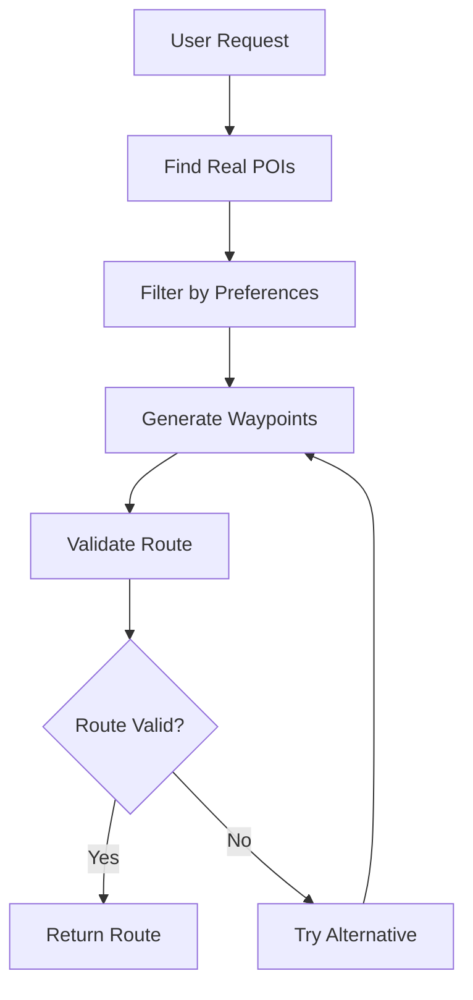

# Real POI System Documentation

## Overview

StrollVibe uses a real-world Point of Interest (POI) system that integrates with OpenStreetMap to provide users with actual destinations for their walking routes. This system replaced the previous mock data approach to ensure users visit genuine places.

## Architecture

### Core Services

#### 1. Real POI Service (`realPOIService.ts`)
- **Purpose**: Queries OpenStreetMap for actual points of interest
- **Data Source**: OpenStreetMap Overpass API
- **Features**:
  - Real-time POI discovery
  - Intelligent caching (30-minute TTL)
  - Category-based filtering
  - Distance-based sorting
  - Fallback POI generation when API fails

#### 2. Route Validation Service (`routeValidationService.ts`)
- **Purpose**: Ensures generated routes are actually walkable
- **Data Source**: Mapbox Directions API
- **Features**:
  - Walkability verification
  - Surface type analysis (paved/unpaved/mixed)
  - Accessibility assessment
  - Elevation profile analysis
  - Route quality warnings

#### 3. Updated Route Generation Service (`routeGeneration.ts`)
- **Purpose**: Creates walking routes using real POI data
- **Integration**: Uses both POI and validation services
- **Features**:
  - Real destination routing
  - Preference-based POI selection
  - Route type support (circular, out-and-back, linear)
  - Comprehensive route metrics

## How It Works

### 1. POI Discovery Process

```typescript
// User sets preferences and location
const preferences = {
  preferParks: true,
  preferFood: true,
  preferCulture: false
}

// System queries real POIs
const pois = await realPOIService.searchPOIs({
  center: [-122.4194, 37.7749], // San Francisco
  radius: 2000, // 2km radius
  categories: ['nature', 'food'], // Based on preferences
  limit: 20
})
```

### 2. POI Categories and Types

| Category | OSM Types | Examples |
|----------|-----------|----------|
| `nature` | park, garden, playground | Golden Gate Park, Community Garden |
| `food` | cafe, restaurant, bar | Starbucks, Local Bistro, Brewery |
| `culture` | museum, gallery, theatre | MOMA, Historic Theater |
| `recreation` | sports_centre, viewpoint | Gym, Scenic Overlook |
| `shopping` | shop, marketplace | Local Market, Boutique |
| `religious` | church, temple, mosque | St. Mary's Cathedral |

### 3. Route Generation Flow



### 4. Data Structure

#### RealPOI Interface
```typescript
interface RealPOI {
  id: string                    // Unique identifier
  name: string                  // Display name
  coordinates: [number, number] // [longitude, latitude]
  type: POIType                 // Specific type (cafe, park, etc.)
  category: POICategory         // Broader category (food, nature, etc.)
  tags: Record<string, string>  // Raw OSM tags
  distance?: number             // Distance from query center
  description?: string          // Generated description
  openingHours?: string         // Business hours
  amenities?: string[]         // Features (WiFi, parking, etc.)
}
```

#### Route Validation Result
```typescript
interface RouteValidationResult {
  isValid: boolean              // Can this route be walked?
  walkable: boolean            // Is it safe/practical?
  distance: number             // Total distance in meters
  duration: number             // Estimated time in minutes
  surface: 'paved' | 'unpaved' | 'mixed'
  accessibility: 'good' | 'moderate' | 'limited'
  warnings: string[]           // Potential issues
  errors: string[]             // Blocking problems
}
```

## API Integration

### OpenStreetMap Overpass API

**Endpoint**: `https://overpass-api.de/api/interpreter`

**Query Example**:
```overpass
[out:json][timeout:25];
(
  nwr[amenity=cafe](around:2000,37.7749,-122.4194);
  nwr[leisure=park](around:2000,37.7749,-122.4194);
  nwr[tourism=museum](around:2000,37.7749,-122.4194);
);
out center meta;
```

**Rate Limiting**: 
- Built-in caching prevents excessive API calls
- 30-minute cache TTL for POI data
- Graceful fallback to generated POIs if API fails

### Mapbox Directions API

**Endpoint**: `https://api.mapbox.com/directions/v5/mapbox/walking/`

**Usage**:
- Route validation and turn-by-turn directions
- Surface type and accessibility analysis
- Elevation profile data
- Integration with existing Mapbox usage monitoring

## Caching Strategy

### POI Cache
- **Key**: `${center[0]},${center[1]}_${radius}_${categories}_${types}`
- **TTL**: 30 minutes
- **Size Limit**: 100 entries (LRU eviction)
- **Benefits**: Reduces API calls, improves response time

### Cache Management
```typescript
// Cache hit - return immediately
const cached = this.getFromCache(cacheKey)
if (cached) {
  return { ...cached, source: 'cache' }
}

// Cache miss - fetch and store
const result = await this.fetchFromAPI(query)
this.setCache(cacheKey, result)
```

## Error Handling

### Graceful Degradation
1. **API Failure**: Falls back to generated POIs based on preferences
2. **Network Issues**: Uses cached data when available
3. **Rate Limiting**: Implements exponential backoff
4. **Invalid Routes**: Attempts alternative waypoint combinations

### Fallback POI Generation
When OpenStreetMap API fails:
```typescript
// Generate fallback POIs based on user preferences
const fallbackPOIs = this.generateFallbackPOIs(center, radius, preferences)
// These are positioned logically but marked as fallback
```

## Performance Optimizations

### 1. Intelligent Caching
- **Short-term**: In-memory cache for session
- **Medium-term**: 30-minute TTL for POI data
- **Long-term**: Could be extended to localStorage

### 2. Batch Processing
- Single API call retrieves multiple POI types
- Efficient coordinate-based queries
- Minimal data transfer with focused queries

### 3. Smart Filtering
- Pre-filter by distance before detailed analysis
- Category-based relevance scoring
- Preference-weighted POI selection

## Usage Examples

### Basic POI Search
```typescript
const poisNearby = await realPOIService.searchPOIs({
  center: userLocation,
  radius: 1000, // 1km
  categories: ['food', 'nature'],
  limit: 10
})
```

### Route Generation with Real POIs
```typescript
const route = await routeGenerationService.generateRoute({
  center: userLocation,
  preferences: {
    duration: 30,
    difficulty: 'easy',
    preferParks: true,
    preferFood: true
  },
  routeType: 'circular'
})
```

### Route Validation
```typescript
const validation = await routeValidationService.validateRoute(waypoints)
if (validation.walkable) {
  // Route is safe to present to user
  presentRoute(route)
} else {
  // Show warnings or try alternative
  showWarnings(validation.warnings)
}
```

## Data Quality

### POI Quality Indicators
- **Completeness**: Name, location, type always present
- **Accuracy**: Direct from OpenStreetMap contributors
- **Freshness**: Real-time API queries with caching
- **Relevance**: Distance and preference-based scoring

### Route Quality Metrics
- **Walkability**: Validated against actual street data
- **Safety**: Avoids highways, construction zones
- **Accessibility**: Surface type and grade analysis
- **Interest**: Balanced POI distribution along route

## Future Enhancements

### Planned Improvements
1. **Enhanced POI Data**: Reviews, photos, real-time hours
2. **Better Caching**: Persistent storage, smarter invalidation
3. **Community Data**: User-contributed POI ratings
4. **Real-time Updates**: Dynamic POI status (open/closed)
5. **Personalization**: Learning user preferences over time

### Integration Possibilities
- **Mapbox Places API**: Richer POI data for urban areas
- **Google Places API**: Additional business information
- **Local APIs**: City-specific attractions and events
- **Weather Integration**: POI recommendations based on conditions

## Monitoring and Analytics

### Key Metrics
- **POI API Success Rate**: Percentage of successful Overpass queries
- **Cache Hit Rate**: Efficiency of caching strategy
- **Route Validation Rate**: Percentage of walkable generated routes
- **User Satisfaction**: Completion rates for generated routes

### Error Tracking
- **API Failures**: Overpass API downtime/errors
- **Route Failures**: Unwalkable route generation attempts
- **Fallback Usage**: Frequency of fallback POI generation
- **Performance Issues**: Slow response times or timeouts

This system provides a solid foundation for real-world walking route generation while maintaining excellent user experience through intelligent caching, error handling, and graceful degradation.