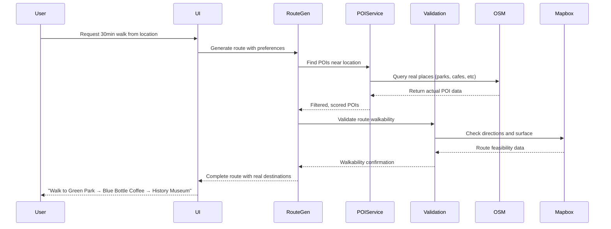

# StrollVibe System Overview

## What is StrollVibe?

StrollVibe is a **real-world walking discovery platform** that helps users find and generate walking routes to actual places. Think "Strava meets AllTrails for urban walking" - it connects people with genuine local destinations rather than just geometric routes.

## Core Value Proposition

### Before: Algorithmic Routes
- Walking apps generated routes based on distance/time calculations
- Users walked to random coordinates with no real destinations
- Routes might lead to parking lots, construction sites, or dead ends
- No guarantee of interesting or safe walking paths

### After: Real-World Discovery
- **Actual Destinations**: Routes go to real cafes, parks, museums, historic sites
- **Verified Walkability**: All routes validated using real street data
- **Rich Context**: Users know what they'll see and experience
- **Local Discovery**: Find hidden gems and genuine points of interest

## System Architecture

### High-Level Components

```
┌─────────────────────────────────────────────────────────────┐
│                    User Interface                           │
│  ┌─────────────────┐    ┌─────────────────────────────────┐ │
│  │   Unified Map   │    │     Walk Details Cards          │ │
│  │   Interface     │    │   (Discover & Generated)       │ │
│  └─────────────────┘    └─────────────────────────────────┘ │
└─────────────────────────────────────────────────────────────┘
           │                              │
           ▼                              ▼
┌─────────────────────────────────────────────────────────────┐
│                Core Services Layer                          │
│  ┌──────────────┐  ┌──────────────┐  ┌──────────────────┐  │
│  │  Real POI    │  │    Route     │  │     Route        │  │
│  │  Service     │  │  Generation  │  │   Validation     │  │
│  │              │  │   Service    │  │    Service       │  │
│  └──────────────┘  └──────────────┘  └──────────────────┘  │
└─────────────────────────────────────────────────────────────┘
           │                              │
           ▼                              ▼
┌─────────────────────────────────────────────────────────────┐
│                External APIs                                │
│  ┌──────────────┐  ┌──────────────┐  ┌──────────────────┐  │
│  │ OpenStreetMap│  │    Mapbox    │  │     Mapbox       │  │
│  │ Overpass API │  │ Directions   │  │   Geocoding      │  │
│  │   (POI Data) │  │     API      │  │      API         │  │
│  └──────────────┘  └──────────────┘  └──────────────────┘  │
└─────────────────────────────────────────────────────────────┘
```

### Key Services

#### 1. Real POI Service
- **Purpose**: Find actual places worth visiting
- **Data Source**: OpenStreetMap via Overpass API
- **Output**: Restaurants, parks, museums, historic sites, viewpoints
- **Intelligence**: Preference-based filtering and scoring

#### 2. Route Generation Service
- **Purpose**: Create walking routes through real destinations
- **Input**: User location, preferences, duration
- **Output**: Validated routes with turn-by-turn directions
- **Types**: Circular, out-and-back, linear routes

#### 3. Route Validation Service
- **Purpose**: Ensure routes are actually walkable
- **Validation**: Surface type, accessibility, safety
- **Fallback**: Alternative routes when validation fails

## How It Works

### User Journey: Discovering Walks

1. **Visit /map** → See unified interface with two modes
2. **Search Location** → Enter address or use GPS
3. **View Location Pin** → Blue pin shows selected starting point
4. **Browse Walks** → Filter by duration, difficulty, scenery
5. **Select Walk** → See route details and map visualization
6. **Start Walking** → Begin guided navigation

### User Journey: Generating Custom Routes

1. **Switch to Generate Mode** → Toggle in interface
2. **Set Starting Location** → Search or GPS with map pin
3. **Choose Preferences** → Duration, difficulty, POI types
4. **Generate Route** → System creates route through real places
5. **Review Route** → See destinations: "30min walk via Central Park, Starbucks, Art Museum"
6. **Start or Regenerate** → Begin walk or try different options

### Behind the Scenes: Route Generation



## Technical Implementation

### Real POI Discovery

**OpenStreetMap Integration**:
```typescript
// Query for actual places
const query = `
[out:json][timeout:25];
(
  nwr[amenity=cafe](around:2000,${lat},${lng});
  nwr[leisure=park](around:2000,${lat},${lng});
  nwr[tourism=museum](around:2000,${lat},${lng});
);
out center meta;
`
```

**Smart Caching**:
- 30-minute cache for POI data
- Location-based cache keys
- Graceful fallback when API unavailable

### Route Validation

**Mapbox Directions API**:
```typescript
// Validate route is walkable
const validation = await routeValidationService.validateRoute(waypoints)
if (!validation.walkable) {
  // Try alternative route or show warnings
}
```

**Quality Checks**:
- Surface type analysis (paved/unpaved)
- Accessibility assessment
- Elevation and difficulty analysis
- Safety considerations

### User Interface

**Unified Map Experience**:
- Single page for both discovery and generation
- Mode toggle: Discover ↔ Generate
- Real-time location search with map pins
- Integrated filtering and preferences

**Visual Feedback**:
- **Blue Pin**: User's searched location
- **Green Markers**: Available walks with duration
- **Route Lines**: Generated walking paths
- **Detail Cards**: Rich information overlays

## Data Flow

### POI Data Pipeline

1. **User Request** → Location + preferences
2. **Cache Check** → Look for existing POI data
3. **API Query** → OpenStreetMap Overpass API
4. **Data Processing** → Parse, categorize, score POIs
5. **Filtering** → Apply user preferences
6. **Caching** → Store for future requests
7. **Return** → Real places with rich metadata

### Route Generation Pipeline

1. **POI Discovery** → Find real destinations
2. **Waypoint Selection** → Choose optimal POIs
3. **Route Creation** → Connect waypoints logically
4. **Validation** → Ensure walkability
5. **Metrics Calculation** → Distance, time, elevation
6. **Presentation** → Rich route description

## Real-World Examples

### Generated Route Example
**Input**: "30-minute walk from Union Square, prefer parks and cafes"

**Output**: 
- **Route Name**: "Scenic Park Walk via Downtown Coffee"
- **Destinations**: 
  - Start: Union Square
  - → Washington Square Park (8 min)
  - → Joe Coffee (15 min)
  - → Mercer Playground (25 min)
  - → Return to Union Square (30 min)
- **Details**: 1.8 miles, 145 calories, 30ft elevation gain

### POI Data Example
```json
{
  "id": "osm_way_12345",
  "name": "Washington Square Park",
  "coordinates": [-74.0027, 40.7308],
  "type": "park",
  "category": "nature",
  "description": "Historic park with fountain and arch",
  "amenities": ["Free WiFi", "Restrooms", "Playground"],
  "openingHours": "06:00-01:00"
}
```

## Performance & Reliability

### Caching Strategy
- **POI Cache**: 30-minute TTL, location-based keys
- **Route Cache**: Session-based for user experience
- **Geocoding Cache**: 24-hour TTL for location searches

### Error Handling
- **API Failures**: Graceful fallback to generated POIs
- **Network Issues**: Use cached data when available
- **Invalid Routes**: Alternative waypoint selection
- **Rate Limiting**: Intelligent request throttling

### Scalability
- **Efficient Queries**: Targeted geographic searches
- **Batch Processing**: Multiple POI types in single request
- **Smart Filtering**: Reduce processing overhead
- **CDN Integration**: Fast map tile delivery

## Quality Assurance

### Data Quality
- **POI Accuracy**: Direct from OpenStreetMap contributors
- **Route Validation**: Real-world walkability verification
- **Freshness**: Real-time API queries with caching
- **Completeness**: Required fields always present

### User Experience
- **Fast Loading**: Optimized queries and caching
- **Intuitive Interface**: Clear mode switching and controls
- **Visual Feedback**: Immediate response to user actions
- **Error Recovery**: Graceful handling of edge cases

## Future Enhancements

### Planned Features
1. **Enhanced POI Data**: Reviews, photos, real-time hours
2. **Community Features**: User ratings and reviews
3. **Personal History**: Track completed walks
4. **Social Sharing**: Share routes with friends
5. **Offline Mode**: Download walks for offline use

### Technical Improvements
1. **Machine Learning**: Better POI scoring and recommendations
2. **Real-time Updates**: Live POI status (open/closed)
3. **Advanced Validation**: Weather and safety considerations
4. **Performance**: Faster route generation and validation

## Development Setup

### Environment Variables
```bash
NEXT_PUBLIC_MAPBOX_ACCESS_TOKEN=your_token_here
MAPBOX_USAGE_ENVIRONMENT=development
```

### Key Dependencies
- **OpenStreetMap**: Overpass API for POI data
- **Mapbox**: Maps, directions, geocoding
- **Next.js**: React framework
- **TypeScript**: Type safety

### Running the System
```bash
npm install
npm run dev
```

Visit `http://localhost:3000/map` to see the unified interface.

## Conclusion

StrollVibe transforms walking from a basic exercise into a discovery experience by connecting users with real places in their neighborhoods. The system provides:

- **Real Destinations**: Actual cafes, parks, museums instead of random coordinates
- **Verified Routes**: All paths checked for walkability and safety
- **Rich Context**: Users know what they'll experience on their walk
- **Unified Experience**: Single interface for both discovery and generation

This foundation enables future enhancements like community features, personal tracking, and social sharing while maintaining the core value of connecting people with genuine local destinations.